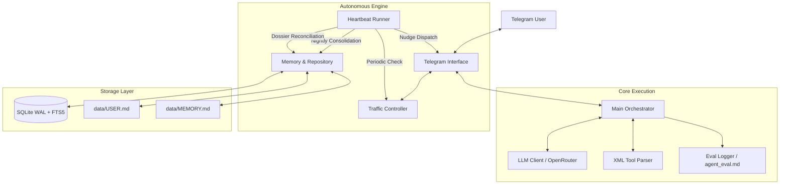

# Vigil (v0.1.0) — Semi-Autonomous AI Partner & Technical Copilot

Vigil adalah agen AI semi-otonom proaktif yang dirancang untuk mendampingi seorang *solo developer* atau profesional teknis. Berjalan tanpa henti (*long-running daemon*) menghubungkan antarmuka **Telegram**, model bahasa besar (LLM), sistem memori persisten bertingkat (**Markdown & SQLite FTS5**), loop detak jantung (**Autonomous Heartbeat**), dan kontrol lalu lintas pesan (**Traffic Controller**).

---

## 📑 Daftar Isi
1. [Arsitektur Sistem](#-arsitektur-sistem)
2. [Fitur Utama](#-fitur-utama)
3. [Daftar Perintah Telegram (Commands & Menus)](#-daftar-perintah-telegram-commands--menus)
4. [Spesifikasi XML Tool Contract](#-spesifikasi-xml-tool-contract)
5. [Variabel Lingkungan (.env)](#-variabel-lingkungan-env)
6. [Panduan Deployment VPS Linux (Systemd)](#-panduan-deployment-vps-linux-systemd)
7. [Pengujian Lokal (Testing)](#-pengujian-lokal-testing)

---

## 🏛️ Arsitektur Sistem



---

## 🚀 Fitur Utama

### 1. Autonomous Heartbeat & Proactive Nudges
- **Background Loop**: Berjalan periodik (default tiap 15 menit) memeriksa tugas yang jatuh tempo (*due/overdue*).
- **Proactive Notification**: Mengirim pesan pengingat ke Telegram tanpa menunggu pesan dari pengguna.
- **Traffic Controller Guard**:
  - **Cooldown**: Minimal jeda 45 menit antar pengingat untuk tugas yang sama; maksimal 3 pengingat per 6 jam.
  - **Quiet Hours**: Meredam notifikasi otomatis pada jam istirahat (23:00 – 07:00 waktu lokal), kecuali jika pengguna aktif berinteraksi.

### 2. Hierarchical Memory Architecture
- **Working Memory (`data/MEMORY.md`)**: Berisi prioritas aktif, status proyek harian, dan fokus saat ini yang selalu diinjeksi ke dalam konteks prompt utama.
- **User Dossier (`data/USER.md` & SQLite)**: Menyimpan preferensi teknis, kebiasaan (*habit*), identitas, dan komitmen pengguna jangka panjang.
- **Technical Lab Notes**: Tempat penyimpanan keputusan arsitektur, catatan teknis, dan solusi kode modular.
- **SQLite FTS5 (Full-Text Search)**: Mesin pencarian teks cepat dengan perankingan BM25 untuk riwayat percakapan dan catatan riset teknis.

### 3. Nightly Consolidation & Sunday Reconciliation
- **Nightly Memory Evaluation**: Setiap malam setelah pukul 21:00, Vigil mengevaluasi capaian hari itu, merangkum progres, dan merapikan *working memory*.
- **Sunday Dossier Reconciliation**: Setiap Minggu malam pukul 23:00 (atau otomatis saat item dossier mencapai ≥ 20 item), Vigil memicu rekonsiliasi untuk menggabungkan fakta duplikat, menyelesaikan kontradiksi, dan merapikan format bullet markdown.

### 4. Deterministic Administrative Menus
- Dashboard interaktif Telegram menggunakan *inline keyboard* bernomor untuk mengelola tugas, catatan lab, fakta profil, dan *working memory* secara langsung tanpa membebani kuota LLM.

### 5. Observability & Diagnostics
- **Live Process Tracing**: Menampilkan langkah *reasoning*, pemanggilan tool, dan pembacaan memori secara *live streaming/editing* di chat Telegram.
- **Token-Dense Eval Logger**: Mencatat setiap sesi interaksi ke file Markdown terstruktur (`logs/agent_eval.md`), khusus dioptimalkan untuk evaluasi kualitas agen tanpa *noise* infrastruktur.

---

## 📱 Daftar Perintah Telegram (Commands & Menus)

Semua perintah dilindungi oleh whitelist ID pengguna (`TELEGRAM_ALLOWED_USER_ID`). Pesan dari user lain akan otomatis ditolak.

### 1. Perintah Interaktif (Dashboard Administrasi)

| Command | Alias | Deskripsi |
| :--- | :--- | :--- |
| `/task` | `/tasks` | Membuka dashboard tugas interaktif. Terdapat tab filter status (**Pending**, **Progress**, **Selesai**, **Semua**) dan mode **Hapus** dengan tombol angka `[ 1 ] [ 2 ] ...`. |
| `/profil` | `/profile`, `/fakta` | Membuka dashboard fakta profil pengguna. Filter kategori (**Semua**, **Pref**, **Habit**, **Identitas**) serta tombol hapus fakta yang otomatis tersinkronisasi ke SQLite dan `data/USER.md`. |
| `/notes` | `/note`, `/catatan` | Menampilkan 5 catatan riset teknis (*lab notes*) terakhir, tombol **Refresh**, dan tombol hapus bernomor. |
| `/memory` | `/fokus` | Menampilkan preview isi `data/MEMORY.md` saat ini, tombol **Refresh**, dan dialog konfirmasi **Kosongkan** (*Reset working memory*). |

### 2. Perintah Kontrol & Operasional

| Command | Parameter | Deskripsi |
| :--- | :--- | :--- |
| `/start` | - | Memeriksa ketersediaan bot dan memastikan koneksi aktif. |
| `/trace` | `on` \| `off` (atau `aktif` / `nonaktif`) | Mengaktifkan/menonaktifkan mode live tracing progres aksi di pesan Telegram. |
| `/stop` | `/batal` | Membatalkan eksekusi LLM yang sedang berlangsung (*cancel active task*). |
| `/retry` | `/ulang` | Menjalankan ulang perintah atau pesan terakhir yang gagal/dibatalkan tanpa perlu mengetik ulang. |

---

## 🛠️ Spesifikasi XML Tool Contract

Model berinteraksi dengan dunia luar dan database secara ketat menggunakan tag XML berikut:

### Write Tools (Mutasi State)
1. **Record User Dossier**:
   ```xml
   <record_dossier category="habit|preference|commitment|identity">Fakta permanen tentang user</record_dossier>
   ```
2. **Save Technical Lab Note**:
   ```xml
   <save_lab_note topic="Topik Singkat" tags="tag1, tag2">Insight teknis lengkap</save_lab_note>
   ```
3. **Create Task**:
   ```xml
   <create_task due="YYYY-MM-DD HH:MM:SS">Judul tugas</create_task>
   ```
4. **Update Task**:
   ```xml
   <update_task id="tsk_..." status="pending|in_progress|done|cancelled">Alasan perubahan status</update_task>
   ```
5. **Update Working Memory**:
   ```xml
   <update_working_memory>Dokumen markdown lengkap untuk data/MEMORY.md</update_working_memory>
   ```

### Read Tools (Query Data & Follow-Up Loop)
1. **Search Lab Notes**: `<search_notes limit="3">2-4 kata kunci</search_notes>`
2. **Search Chat History**: `<search_chat limit="3">2-4 kata kunci</search_chat>`
3. **Query Tasks**: `<query_tasks status="pending|in_progress|done|cancelled|all" limit="10"></query_tasks>`
4. **Get User Dossier**: `<get_dossier limit="5">kategori_opsional</get_dossier>`

---

## ⚙️ Variabel Lingkungan (.env)

Buat file `.env` di root direktori proyek (salin dari `.env.example`):

```bash
# Telegram Bot Configuration
TELEGRAM_BOT_TOKEN=123456789:ABCDefGhIJKlmNoPQRsTUVwxyZ
TELEGRAM_ALLOWED_USER_ID=987654321

# LLM API Configuration (OpenAI Compatible / OpenRouter)
LLM_API_KEY=sk-or-v1-xxxxxxxxxxxxxxxxxxxx
LLM_BASE_URL=https://openrouter.ai/api/v1
LLM_MODEL_NAME=meta-llama/llama-3.3-70b-instruct

# Storage & Database Configuration
DATABASE_PATH=data/vigil.db

# Engine / Heartbeat Configuration (dalam menit)
HEARTBEAT_INTERVAL_MINUTES=15

# Timezone Configuration (IANA format)
TIMEZONE=Asia/Jakarta

# Observability Configurations
ENABLE_PROCESS_TRACING=false
ENABLE_EVAL_LOG=false
EVAL_LOG_PATH=logs/agent_eval.md
LOG_LEVEL=INFO
```

---

## 🐧 Panduan Deployment VPS Linux (Systemd)

Panduan berikut mengasumsikan instalasi pada VPS Linux (Ubuntu 22.04 / 24.04 atau Debian 12) tanpa Docker.

### 1. Persiapan Server & Prasyarat
Pastikan server memiliki Python 3.11 atau lebih baru, Git, dan pip:
```bash
sudo apt update && sudo apt install -y python3 python3-venv python3-pip git
python3 --version  # Harus >= 3.11
```

### 2. Clone Repositori ke `/opt/vigil`
```bash
sudo git clone <URL_REPOSITORY_ANDA> /opt/vigil
sudo chown -R $USER:$USER /opt/vigil
cd /opt/vigil
```

### 3. Buat Python Virtual Environment & Install Dependensi
```bash
python3 -m venv .venv
source .venv/bin/activate
pip install --upgrade pip
pip install -r requirements.txt
```

### 4. Siapkan File Konfigurasi `.env`
```bash
cp .env.example .env
nano .env
```
Isi `TELEGRAM_BOT_TOKEN`, `TELEGRAM_ALLOWED_USER_ID`, dan `LLM_API_KEY` dengan kredensial Anda.

### 5. Pastikan Folder Data & Log Memiliki Izin Tulis
```bash
mkdir -p /opt/vigil/data /opt/vigil/logs
chmod -R 775 /opt/vigil/data /opt/vigil/logs
```

### 6. Pasang Service Systemd
Salin file template service dari repositori ke direktori systemd:
```bash
sudo cp deploy/vigil.service /etc/systemd/system/vigil.service
```

Buka file service untuk menyesuaikan user/grup dengan user login VPS Anda:
```bash
sudo nano /etc/systemd/system/vigil.service
```
Pastikan baris `User` dan `Group` sesuai (misal: `User=ubuntu` atau `User=root` jika menggunakan server root).

### 7. Aktifkan & Jalankan Daemon
```bash
sudo systemctl daemon-reload
sudo systemctl enable --now vigil
```

### 8. Memeriksa Status & Log Operasional
- **Cek Status Service**:
  ```bash
  sudo systemctl status vigil
  ```
- **Pantau Log Real-time**:
  ```bash
  journalctl -u vigil -f
  ```

### 9. Prosedur Update Kode di Server
Jika ada pembaruan kode di kemudian hari:
```bash
cd /opt/vigil
git pull origin main
source .venv/bin/activate
pip install -r requirements.txt
sudo systemctl restart vigil
```

---

## 🧪 Pengujian Lokal (Testing)

Sebelum melakukan deployment, seluruh suite pengujian dapat dijalankan secara lokal:

```bash
# Menggunakan Git Bash di Windows atau terminal Linux
source .venv/bin/activate
PYTHONPATH=. pytest -v
```

Total **133 unit & integration test** mencakup evaluasi memori, pemrosesan FTS5, eksekusi tool multi-turn, batas kuota, penanganan sinyal graceful shutdown, dan otorisasi whitelist.
